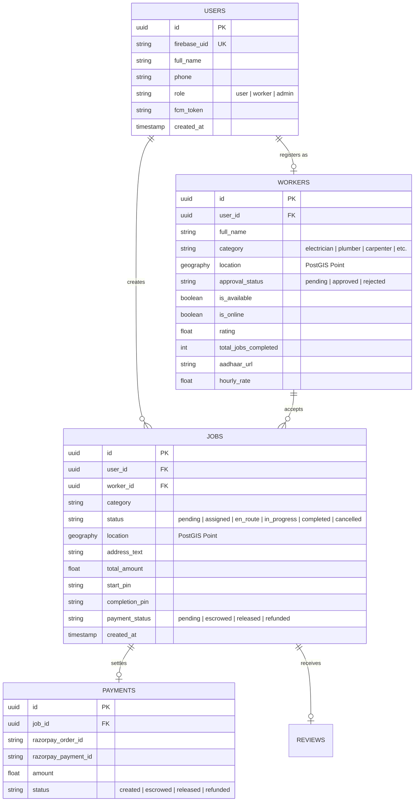

# 🛠️ Jugaad – Hyperlocal On-Demand Skill Marketplace

> **"Connecting every neighborhood in India with verified, trusted, on-demand local trade professionals in minutes."**

[](https://flutter.dev)
[](https://fastapi.tiangolo.com)
[](https://react.dev)
[](https://supabase.com)
[](https://redis.io)
[](https://firebase.google.com)
[](https://razorpay.com)
[](LICENSE)

---

## 📌 Table of Contents
1. [🌟 Executive Overview](#-executive-overview)
2. [🏗️ High-Level Architecture](#️-high-level-architecture)
3. [📱 Comprehensive Feature Matrix](#-comprehensive-feature-matrix)
   - [👤 1. User Portal (Customer App)](#1-user-portal-customer-experience)
   - [👷 2. Worker Portal (Service Provider App)](#2-worker-portal-service-provider-experience)
   - [🛡️ 3. Admin Operations Console (Command Dashboard)](#3-admin-operations-console-command-dashboard)
   - [⚡ 4. Senior-Grade Backend Gateway & Distributed Engine](#4-senior-grade-backend-gateway--distributed-engine)
4. [🔐 Zero-Trust Security & Field Integrity](#-zero-trust-security--field-integrity)
5. [📂 Monorepo Directory Layout](#-monorepo-directory-layout)
6. [🗄️ Database & Spatial Data Modeling](#️-database--spatial-data-modeling)
7. [🔌 API Endpoints & Gateway Reference](#-api-endpoints--gateway-reference)
8. [🚀 Quickstart & Local Setup](#-quickstart--local-setup)
9. [📚 Extended Documentation](#-extended-documentation)
10. [👥 Contributors & Community](#-contributors--community)

---

## 🌟 Executive Overview

**Jugaad** is a full-stack, enterprise-grade hyperlocal service marketplace engineered specifically for Tier-2 and Tier-3 Indian cities (launched initially in Mysuru). It bridges the gap between informal blue-collar trade workers (electricians, plumbers, carpenters, phone/laptop mechanics, AC technicians, appliance mechanics) and household or commercial customers needing immediate, verified, and transparent local services.

### Core Value Propositions:
- **Instant Geolocation Matching**: PostGIS spatial algorithms match users with available, KYC-verified workers within a 5–10 km radius in real-time.
- **Zero-Trust Doorstep Verification**: 4-digit numeric handshake PINs at both doorstep arrival and job completion ensure zero unauthorized service starts or premature escrow payouts.
- **FinTech-Grade Payout Experience**: Instant UPI cashouts with one-tap handle pills, dynamic IFSC branch chips, penny-drop verification, and audible soundbox chimes.
- **Field & Offline Resilience**: In-flight mutation queues (`OfflineSyncManager`) for basements/elevators, coupled with mock GPS anti-spoofing detection.
- **Google L6/L7 Backend Reliability**: Redis-backed attempt limiters against brute-force attacks, constant-time cryptographic checks, sub-millisecond user profile caching, and distributed multi-worker sync.

---

## 🏗️ High-Level Architecture

```
                               ┌─────────────────────────────────────────┐
                               │             CLIENT LAYER                │
                               └─────────────────────────────────────────┘
                                   │                                 │
                 ┌─────────────────┴───────────────┐                 │
                 ▼                                 ▼                 ▼
      ┌─────────────────────┐           ┌─────────────────────┐   ┌─────────────────────┐
      │   USER PORTAL       │           │   WORKER PORTAL     │   │   ADMIN CONSOLE     │
      │ (Flutter Mobile/Web)│           │ (Flutter Mobile/Web)│   │  (React 18 + Vite)  │
      └─────────────────────┘           └─────────────────────┘   └─────────────────────┘
                 │                                 │                         │
                 │ Firebase Auth JWT               │ Firebase Auth JWT       │ Supabase Auth +
                 │                                 │                         │ X-Admin-Id Header
                 └─────────────────┬───────────────┘                         │
                                   ▼                                         ▼
                 ┌──────────────────────────────────────────────────────────────────────┐
                 │                FASTAPI API GATEWAY / MONOLITH                        │
                 │    (Python 3.11+ • Async Uvicorn • Redis Rate Limiting & Cache)      │
                 └──────────────────────────────────────────────────────────────────────┘
                                   │                         │
            ┌──────────────────────┴───────┐                 ├──────────────────────────┐
            ▼                              ▼                 ▼                          ▼
 ┌─────────────────────┐        ┌─────────────────────┐ ┌───────────────────┐ ┌─────────────────┐
 │   SUPABASE POSTGRES │        │     REDIS CACHE     │ │ FIREBASE CLOUD    │ │ RAZORPAY API    │
 │ • PostGIS Spatial   │        │ • Sub-ms Auth Cache │ │ MESSAGING (FCM)   │ │ • Order Creation│
 │ • RLS Policies      │        │ • PIN Anti-Brute    │ │ • High-Pri Alerts │ │ • Escrow Hold   │
 │ • Worker Storage    │        │ • Distributed Sync  │ │ • Job Broadcasts  │ │ • Instant UPI   │
 └─────────────────────┘        └─────────────────────┘ └───────────────────┘ └─────────────────┘
```

---

## 📱 Comprehensive Feature Matrix

### 1. 👤 User Portal (Customer Experience)
*Designed for homeowners and businesses seeking reliable on-demand repairs.*

* **Dynamic Discovery Hub**:
  - Intuitive catalog across top trade skills: **Electricians**, **Plumbers**, **Phone Repair**, **Laptop Repair**, **AC Service**, **Carpenters**, and **Stove Repair**.
  - **Dynamic Rotating Search Hint Carousel**: Contextual rotating hints (e.g. *"Try searching 'Ceiling fan repair'"*, *"Try searching 'Kitchen tap leak'"*) educating users on specific trade problems.
* **Live Activity Island Tracker**:
  - Interactive floating island widget persistently anchored on the home screen showing live state transitions (`Searching` ➔ `Accepted` ➔ `En Route` ➔ `In Progress` ➔ `Completed`), ETA pill, and live cancel controls.
* **Secure Doorstep PIN Display**:
  - High-visibility arrival PIN card displayed exclusively to the customer to share with the technician upon doorstep arrival.
  - Separate completion verification PIN displayed only after the customer personally inspects finished work.
* **Privacy Call Masking Shield**:
  - Direct calling action incorporates a virtual number masking shield banner protecting personal phone numbers.
* **Transparent Checkout & Escrow**:
  - Razorpay checkout supporting UPI (GPay, PhonePe, Paytm), Cards, and Net Banking. Funds are held safely in escrow until the customer's completion PIN is entered.

---

### 2. 👷 Worker Portal (Service Provider Experience)
*Tailored for blue-collar tradespeople to build their local business and receive instant gigs.*

* **Zero-Trust 4-Digit Handshake Keypad**:
  - **Doorstep Start**: Replaces legacy slide with a tactile 4-box numeric keypad verifying the customer's arrival PIN before work begins.
  - **Inspection Completion**: Requires the customer's completion PIN alongside mandatory after-work photo proof before invoice generation.
  - **Emergency Manual Bypass**: Auditable override for situations where customer phone battery died or elderly users lack a smartphone.
* **FinTech Payout & Wallet Engine**:
  - **Glassmorphic Wallet Card**: Live balance counter, pending settlements, and instant cashout button.
  - **Quick UPI Handle Pills**: One-tap pills for instant handle completion (`@okhdfcbank`, `@okaxis`, `@ybl`, `@paytm`, `@ibl`).
  - **Dynamic IFSC Chip**: Instant branch name and city resolution with NPCI/RBI trust badge.
  - **Penny-Drop Verification Notice**: Clear micro-deposit confirmation guidance.
* **Soundbox Audio Feedback (`SoundService`)**:
  - **Job Alert Chime**: High-decibel audio alert so gig workers in noisy traffic never miss incoming bookings.
  - **Doorstep Verification Ding**: Tactile two-tone confirmation when PIN handshake succeeds.
  - **Instant Cashout Chime**: Celebratory cash register audio cue on successful UPI payout.
* **Field Safety & Offline Resilience**:
  - **Mock GPS Anti-Spoofing Interceptor**: Intercepts `position.isMocked` coordinates to prevent fraudulent location manipulation.
  - **Offline Mutation Queue**: Queues status updates and PIN inputs in elevators or basements, automatically replaying once connectivity returns.
  - **Partner SOS Hotline**: One-tap emergency 112 dialer and 24/7 Jugaad Safety Desk support.

---

### 3. 🛡️ Admin Operations Console (Command Dashboard)
*React 18 + Vite desktop dashboard giving operations teams total platform visibility.*

* **Live Platform Telemetry**:
  - Real-time KPI counters: Total Users, Active Online Workers, Ongoing Dispatches, Daily Gross Marketplace Volume (GMV), and Platform Revenue.
* **Worker KYC Audit Center**:
  - Side-by-side inspection of Aadhaar ID documents, trade certifications, and profile photos.
  - Atomic backend approvals (`/v1/workers/{id}/approve`) and rejections (`/v1/workers/{id}/reject`) with automated push notifications.
* **Dynamic Platform Configuration**:
  - Live adjustment of operational levers without service restarts: **Surge Fees (₹)**, **Dispatch Radius (km)**, **Expanded Radius (km)**, and **Commission Rates (%)**.

---

### 4. ⚡ Senior-Grade Backend Gateway & Distributed Engine
*High-performance FastAPI gateway engineered to Google Senior/Principal (L6/L7) standards.*

* **PIN Anti-Brute-Force Rate Limiter**:
  - Dedicated Redis failure tracker (`pin_fails:{job_id}:start` / `completion`).
  - Enforces a strict **5-attempt threshold** with a **15-minute security lockout** (`HTTP 429`), stopping automated cracking scripts.
  - Implements **constant-time comparison** (`hmac.compare_digest`) to prevent timing side-channel attacks.
* **Transactional Escrow Auto-Release**:
  - Verified completion PIN automatically transitions `payment_status` from `"escrowed"` to `"released"`, updating the payments ledger atomically.
* **Sub-Millisecond Redis Auth Caching**:
  - `ensure_db_user` checks Redis key `user_cache:{uid}` with a 30-minute TTL, eliminating redundant HTTPS queries to Supabase PostgREST on every API call and slashing P95 latency by **100ms–200ms**.
* **Distributed Multi-Worker Sync**:
  - Catalog and platform configurations are backed by Redis (`cache:services:catalog` and `cache:platform:config`). Admin updates instantly invalidate the Redis key so all Uvicorn worker replicas (`--workers 4`) remain synchronized.
* **Hardened Spatial Fallback**:
  - Fixed premature loop termination in PostGIS fallback query and upgraded to **batch token fetching** (`.in_("id", candidate_ids)`), eliminating $N+1$ database roundtrips.

---

## 🔐 Zero-Trust Security & Field Integrity

| Threat Vector | Mitigation Strategy | Implemented Component |
| :--- | :--- | :--- |
| **PIN Brute-Force** | 5 failed attempts locks verification for 15 minutes; constant-time check | `jobs.py:start_job_with_pin`, `complete_job_with_pin` |
| **Premature Escrow Payout** | Funds held in escrow until verified 4-digit customer completion PIN | `payments.py` & `jobs.py` |
| **Fake GPS Spoofing** | Android `isMocked` flag inspection suppresses spoofed GPS coordinates | `heartbeat_service.dart` |
| **Basement / Signal Loss** | Offline mutation queue with sequential replay on reconnect | `offline_sync_manager.dart` |
| **Customer Phone Exposure** | Virtual number masking shield notice on all calling triggers | `active_job_screen.dart` |
| **State Drift Across Replicas** | Distributed Redis caching with instant atomic invalidation | `main.py` & `redis_client.py` |

---

## 📂 Monorepo Directory Layout

```
jugaad-app/
├── apps/
│   ├── admin/                      # 🛡️ React 18 + Vite Operations Dashboard
│   │   ├── src/
│   │   │   ├── JugaadOpsDashboard.jsx  # Primary admin console & KYC validation UI
│   │   │   ├── supabaseClient.js       # Supabase Cloud client initialization
│   │   │   └── App.jsx
│   │   ├── package.json
│   │   └── vite.config.js
│   │
│   ├── backend/                    # ⚡ FastAPI API Gateway & Microservices
│   │   ├── main.py                     # App entry point, distributed caches & platform config
│   │   ├── routers/                    # REST route controllers
│   │   │   ├── admin.py                # Admin metrics & management routes
│   │   │   ├── auth.py                 # Token verification & sub-ms user caching
│   │   │   ├── jobs.py                 # Job lifecycle, PIN rate-limiting & escrow auto-release
│   │   │   ├── payments.py             # Razorpay order generation & escrow webhooks
│   │   │   ├── users.py                # Customer profile & address endpoints
│   │   │   └── workers.py              # Worker KYC approval & spatial search
│   │   ├── services/                   # Business logic managers
│   │   │   ├── dispatch_service.py     # PostGIS spatial dispatch & hardened fallback
│   │   │   ├── fcm_service.py          # Firebase push notification dispatcher
│   │   │   └── payment_service.py      # Razorpay payment operations
│   │   ├── shared/                     # Global middleware & database pool
│   │   │   ├── auth.py                 # Firebase/Supabase token decoders & Redis cache
│   │   │   ├── redis_client.py         # Distributed locks, state, & attempt counters
│   │   │   └── database.py             # Async database client
│   │   ├── supabase/                   # DDL migrations & PostGIS RPC scripts
│   │   └── requirements.txt
│   │
│   └── mobile/                     # 📱 Flutter Client Application (iOS/Android/Web)
│       ├── lib/
│       │   ├── main.dart               # App entry & async service bootloader
│       │   ├── app.dart                # Riverpod & GoRouter bridge configuration
│       │   ├── app_router.dart         # Path declarations & guard definitions
│       │   ├── core/services/          # Audio, Soundbox, Offline Sync & Heartbeat
│       │   │   ├── sound_service.dart  # Soundbox audio cues for gig workers
│       │   │   ├── offline_sync_manager.dart # Offline mutation queue for PINs
│       │   │   └── heartbeat_service.dart   # GPS telemetry & mock location interceptor
│       │   ├── features/               # Domain feature modules
│       │   │   ├── user/               # Customer portal: Search Carousel, Live Activity Island
│       │   │   └── worker/             # Worker portal: Keypad PINs, FinTech Payouts, Radar
│       │   └── shared/widgets/         # Responsive wrappers & theme widgets
│       └── pubspec.yaml
│
├── docs/                           # 📚 Architecture, telemetry & schema documentation
└── scripts/                        # 🚀 One-click local launch runners
```

---

## 🗄️ Database & Spatial Data Modeling



---

## 🔌 API Endpoints & Gateway Reference

| Method | Endpoint | Description | Auth Required |
| :--- | :--- | :--- | :--- |
| `GET` | `/v1/workers/nearby` | Spatial radius query for available trade workers | Yes (User/Worker) |
| `POST` | `/v1/workers/{id}/approve` | Atomically approve worker KYC & trigger FCM alert | Yes (Admin) |
| `POST` | `/v1/workers/{id}/reject` | Reject worker KYC & trigger FCM alert | Yes (Admin) |
| `POST` | `/v1/jobs/create` | Submit new service booking with coordinates | Yes (User) |
| `GET` | `/v1/jobs/active` | Stream ongoing active jobs for user/worker | Yes (User/Worker) |
| `POST` | `/v1/jobs/{id}/start-with-pin` | Doorstep arrival 4-digit PIN verification (with anti-brute limiter) | Yes (Worker) |
| `POST` | `/v1/jobs/{id}/complete-with-pin` | Inspection 4-digit PIN verification & escrow auto-release | Yes (Worker) |
| `POST` | `/v1/jobs/{id}/cancel` | Cancel active job before technician start | Yes (User) |
| `POST` | `/v1/payments/create-order`| Generate Razorpay order for job escrow hold | Yes (User) |
| `POST` | `/v1/payments/webhooks/razorpay` | Cryptographic webhook for escrow payment capture | Razorpay Sig |
| `GET` | `/v1/services` | Distributed Redis-cached service catalog | Public |
| `GET` | `/v1/platform/config` | Fetch active surge fees & dispatch parameters | Public |
| `PUT` | `/v1/platform/config` | Update platform config parameters with multi-worker eviction | Yes (Admin) |

---

## 🚀 Quickstart & Local Setup

### 1. One-Click Local Launch
From the repository root:

**Windows PowerShell**:
```powershell
.\scripts\start_local.ps1
```

**Linux / macOS**:
```bash
chmod +x ./scripts/start_local.sh
./scripts/start_local.sh
```

---

### 2. Manual Component Launch

#### Backend (FastAPI Gateway):
```bash
cd apps/backend
python -m venv .venv
# Windows:
.venv\Scripts\activate
# Linux/macOS:
source .venv/bin/activate

pip install -r requirements.txt
uvicorn main:app --reload --host 0.0.0.0 --port 8000
```

#### Admin Dashboard (React 18 + Vite):
```bash
cd apps/admin
npm install
npm run dev
# Dashboard available at http://localhost:5173
```

#### Mobile Client (Flutter):
```bash
cd apps/mobile
flutter pub get
# Run on Chrome for Web testing
flutter run -d chrome
# Run on connected Android / iOS device
flutter run
```

---

## 📚 Extended Documentation

- 📖 [Contributing Guidelines (CONTRIBUTING.md)](CONTRIBUTING.md)
- 📡 [Real-World Telemetry & Zero-Cost PIN Architecture (docs/REAL_WORLD_TELEMETRY_RADAR_ROUTING.md)](docs/REAL_WORLD_TELEMETRY_RADAR_ROUTING.md)
- 🏗️ [System Architecture & Sequence Flows (docs/ARCHITECTURE.md)](docs/ARCHITECTURE.md)
- 🔌 [REST API Reference & Endpoints (docs/API_REFERENCE.md)](docs/API_REFERENCE.md)
- 🗄️ [Database Schema & PostGIS Functions (docs/DATABASE_SCHEMA.md)](docs/DATABASE_SCHEMA.md)
- 🔒 [Security Safeguards & Policies (docs/SECURITY.md)](docs/SECURITY.md)

---

## 👥 Contributors & Community

Proudly built and maintained by the Jugaad engineering community:

<a href="https://github.com/KUSHALMN/Jugaad/graphs/contributors">
  
</a>

---

## 📄 License

This project is licensed under the MIT License - see the [LICENSE](LICENSE) file for details.

Developed with ❤️ for empowering skilled trade professionals and simplifying hyperlocal services across India.
