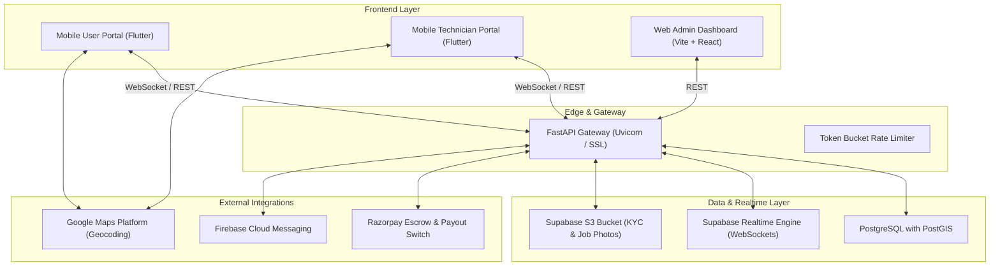

# Jugaad System Architecture & Engineering Specifications

This document outlines the core architectural principles, state management topologies, and real-time synchronization pipelines powering the **Jugaad** hyperlocal services platform.

---

## 1. Client Architecture (Flutter)
* **Architecture Pattern**: Feature-First Layered Architecture with clean domain, data, and presentation boundaries.
* **State Management**: **Flutter Riverpod** handles reactive state and stream subscriptions.
* **Navigation**: **GoRouter 17.x** provides declarative deep-linking and state restoration across web and mobile viewports.
* **Offline Resilience**: Offline actions (e.g. status updates, arrival pings) are queued in a persistent local queue (`OfflineQueueService`) and synchronized automatically upon reconnect.

---

## 2. Real-Time Telemetry & Tracking
* **Kalman Filtering (`KalmanLatLong`)**: Eliminates GPS jitter and noisy multipath reflections common in dense Indian urban corridors.
* **Dead Reckoning & Slerp Interpolation**: Coordinates between 1-second GPS packets are smoothly interpolated on the client canvas at 60 FPS.

---

## 3. Financial & Escrow Engine
* **Perforated Ticket Bill**: Scalloped bill with itemized base fee, materials with photo proof, and platform escrow fee.
* **Zero-Trust OTP Escrow Release**: Payments are held in escrow and released to the worker only upon verification of the customer's 4-digit PIN.
* **Instant Daily UPI Cashout**: Technicians can withdraw verified earnings directly to their bank account via IMPS/UPI with zero transaction fees.

---

## 4. Trust & Safety Infrastructure ("Jugaad Suraksha")
* **Aadhaar Biometric & KYC**: Government-verified identification with criminal record check.
* **1-Tap WhatsApp Live Status**: Pre-formatted WhatsApp share link allowing users to broadcast technician live status to family.
* **Emergency Dispatch**: 1-Tap direct dialing to National Police (112) and 24x7 Safety Command Center.
