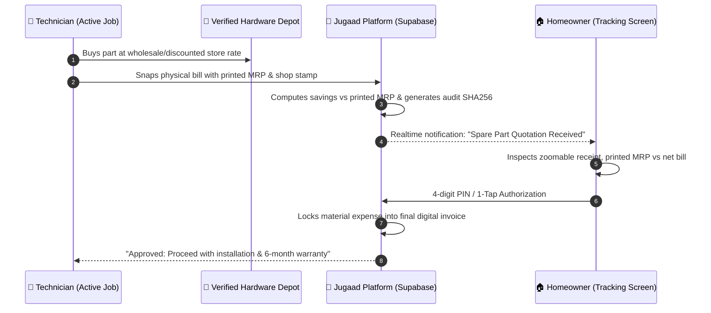

# 🧾 Jugaad Digital Spare Parts & Material Escrow System

## 1. Executive Summary & Problem Context

In traditional Indian on-demand home service marketplaces (e.g. Urban Company, local contractors, Justdial), **over 80% of customer dissatisfaction and rating disputes** originate from off-platform cash claims for replacement spare parts:
> *"Sir, the fan capacitor and copper wire are completely burnt. Pay ₹350 cash so I can purchase it from the market."*

Homeowners feel anxious and suspicious that:
1. The technician is inflating the part's price by 2x to 3x.
2. The platform has zero record or warranty coverage for the part.
3. The old damaged part was swapped with a counterfeit or substandard component.
4. Cash paid off-platform bypasses all guarantee shields.

---

## 2. The Jugaad Solution: 100% Cost Pass-Through & MRP Proof Escrow

Jugaad solves this friction through a **zero-markup, cryptographic material escrow pipeline**:

---

## 3. Core Architectural Components

### A. Domain Model (`SparePartQuotationItem`)
- **File**: `apps/mobile/lib/core/models/spare_part_quotation_item.dart`
- Captures:
  - `mrpPrice`: Manufacturer printed maximum retail price.
  - `billedPrice`: Actual net price charged by verified hardware vendor.
  - `savingsAmount`: Difference passed 100% to the customer.
  - `hardwareStoreName`: Physical merchant name and locality.
  - `receiptPhotoUrl`: Secure URL of the paper cash memo / GST invoice.
  - `auditSignature`: Tamper-evident 16-character SHA-256 fingerprint.

### B. Hardware Proof Scanner (`MrpProofScannerService`)
- **File**: `apps/mobile/lib/core/services/mrp_proof_scanner_service.dart`
- Interfaces with mobile camera and photo picker.
- Validates bill clarity and matches against curated verified hardware partners across Karnataka (Mysuru, Bengaluru, Mandya).

### C. Interactive Inspection Modal (`MrpReceiptViewerDialog`)
- **File**: `apps/mobile/lib/features/shared/widgets/mrp_receipt_viewer_dialog.dart`
- Provides `InteractiveViewer` with 0.8x to 4.0x pinch-to-zoom.
- Enables the customer to read the physical rubber stamp, serial numbers, and printed date on the shop bill.

### D. Technician Quoting Engine (`SparePartsQuotationSheet`)
- **File**: `apps/mobile/lib/features/shared/widgets/spare_parts_quotation_sheet.dart`
- 1-tap quick presets (Motor Capacitor, Modular Switch, Brass Valve, CPVC Solvent).
- Instant camera snap proof button.
- Live status indicators (`⏳ Waiting Approval` vs `✅ Approved`).

### E. Security Handshake PIN Sheet (`SparePartOtpApprovalSheet`)
- **File**: `apps/mobile/lib/features/user/widgets/spare_part_otp_approval_sheet.dart`
- 4-digit PIN verification for high-value parts (> ₹300) preventing unauthorized expenses.

### F. Dual-Tier Digital Bill (`MaterialEscrowBillBreakdown`)
- **File**: `apps/mobile/lib/features/shared/widgets/material_escrow_bill_breakdown.dart`
- Explicitly separates **Platform Labor Visit Fare** from **100% Cost Pass-Through Spare Parts**.
- Highlights customer savings below printed retail MRP.

---

## 4. Multilingual Vernacular Localization

The entire quotation and audit flow supports **Kannada (`kn`)**, **Hindi (`hi`)**, and **English (`en`)** with zero-reload dynamic switching:

| Concept | Kannada (ಕನ್ನಡ) | Hindi (हिंदी) | English |
| :--- | :--- | :--- | :--- |
| **Quotation Header** | ಬಿಡಿಭಾಗಗಳ ಅಧಿಕೃತ ಕೋಟೇಶನ್ & ಎಂಆರ್‌ಪಿ ಸ್ಲಿಪ್ | स्पेयर पार्ट्स डिजिटल कोटेशन और एमआरपी बिल | Spare Parts & Material Quotation |
| **MRP Guarantee** | ಅಂಗಡಿ ಎಂಆರ್‌ಪಿ ರಶೀದಿ ಗ್ಯಾರಂಟಿ: 1 ರೂಪಾಯಿ ಹೆಚ್ಚುವರಿ ಇಲ್ಲ | दुकान एमआरपी रसीद गारंटी: ₹1 भी अतिरिक्त शुल्क नहीं | Store MRP Slip Guarantee: Zero hidden markup |
| **Inspect Store Bill** | ಅಂಗಡಿಯ ಬಿಲ್ & ಎಂಆರ್‌ಪಿ ಪರಿಶೀಲಿಸಿ ↗ | दुकान की रसीद और एमआरपी जांचें ↗ | Inspect Store Bill & MRP ↗ |
| **Approve Escrow** | ಬಿಡಿಭಾಗವನ್ನು ಅನುಮೋದಿಸಿ & ಬಿಲ್‌ಗೆ ಸೇರಿಸಿ | सामग्री मंजूर करें और बिल में जोड़ें | Approve & Lock into Digital Bill |
| **Zero-Markup Rule** | 100% ವೆಚ್ಚ ಪಾಸ್‌-ಥ್ರೂ: ತಂತ್ರಜ್ಞರಿಗೆ ಅಂಗಡಿಯ ನಿಖರ ಮೊತ್ತ | 100% लागत पास-थ्रू: तकनीशियन को दुकान की सटीक कीमत | 100% Cost Pass-Through: Reimbursed at exact store cost |

---

## 5. Verification & Test Suite

All 17 integration and unit tests pass with 0 errors:
- `test/spare_parts_escrow_test.dart` (8 tests)
- `test/ux_elevation_test.dart` (9 tests)
- `flutter analyze`: **0 issues found** (Clean code).
